# 🏮 ChineseMaster (Bucha Chinese)

<div align="center">

**Hệ thống học tiếng Trung và khảo thí khẩu ngữ HSKK thông minh tích hợp Trí tuệ nhân tạo (AI)**

[](https://spring.io/projects/spring-boot)
[](https://www.oracle.com/java/)
[](https://react.dev/)
[](https://www.typescriptlang.org/)
[](https://tailwindcss.com/)
[](https://www.mysql.com/)
[](https://www.docker.com/)
[](https://azure.microsoft.com/)

</div>

---

## 📖 1. Giới thiệu Dự án (Overview)

**ChineseMaster** là nền tảng học tiếng Trung trực tuyến toàn diện, tập trung giải quyết bài toán khó khăn nhất của người học tiếng Trung: **Luyện phát âm chuẩn xác ngữ điệu** và **Rèn luyện kỹ năng thi khẩu ngữ HSKK (HSKK 初级, 中级)**.

Hệ thống kết hợp giữa công nghệ đánh giá phát âm thời gian thực qua **iFlytek ISE (WebSocket)**, mô hình ngôn ngữ lớn **Doubao LLM** để nhận xét bài nói tự do, và thuật toán lặp lại ngắt quãng **Spaced Repetition System (SRS / SM-2)** giúp tối ưu hóa khả năng ghi nhớ từ vựng lâu dài.

### 🌟 Điểm nổi bật
- 🎙️ **Chấm điểm phát âm thời gian thực (Real-time Speech Scoring):** Đánh giá chi tiết theo từng thanh mẫu (Initials), vận mẫu (Finals), thanh điệu (Tones), và độ trôi chảy (Fluency).
- 🏆 **Mô phỏng thi nói HSKK (HSKK Speaking Exam Simulation):** Đầy đủ 3 phần thi tiêu chuẩn (Lặp lại câu, Trả lời câu hỏi, Nói theo chủ đề) kèm đồng hồ đếm ngược và AI tự động sinh nhận xét.
- 🧠 **Flashcards thông minh (SRS Algorithm):** Áp dụng thuật toán SuperMemo-2 (SM-2) tự động tính toán chu kỳ ôn tập (interval, E-factor, repetition box).
- 📊 **Bài kiểm tra năng lực phát âm (Assessment Test 4 phần):** Đánh giá toàn diện kiến thức phát âm từ cơ bản đến câu hoàn chỉnh.
- 🏫 **Quản lý lớp học & Bảng xếp hạng:** Theo dõi học viên, xếp hạng luyện tập hàng ngày (Daily Leaderboard) và quản trị viên (Admin Dashboard).

---

## 🏗️ 2. Kiến trúc Hệ thống (System Architecture)

Dự án được xây dựng theo kiến trúc hiện đại, tách biệt hoàn toàn giữa Frontend Single Page Application (SPA) và Backend RESTful Service:

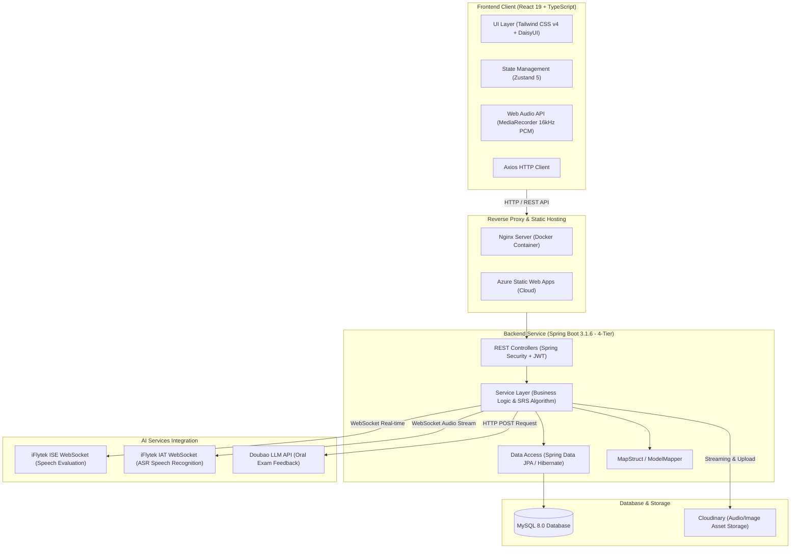

---

## 🗄️ 3. Sơ đồ Cơ sở Dữ liệu (Database ERD)

Toàn bộ **25 bảng cơ sở dữ liệu** được ánh xạ thông qua các JPA Entity trong mã nguồn (`com.bucha.entity`), quản lý bằng **MySQL 8.0**:

```mermaid
erDiagram
    %% 1. Quản lý Người dùng & Lớp học
    USERS ||--o{ USER_BADGES : "owns"
    USERS ||--o{ CLASS_MEMBERSHIPS : "joins"
    CLASSES ||--o{ CLASS_MEMBERSHIPS : "contains"
    USERS ||--o{ USER_LESSONS : "tracks"
    LESSONS ||--o{ USER_LESSONS : "tracked_in"

    %% 2. Nội dung Học tập & Giáo trình
    CURRICULUMS ||--o{ LESSONS : "contains"
    LESSONS ||--o{ CONVERSATIONS : "has"
    CONVERSATIONS ||--o{ CONVERSATION_LINES : "contains"
    LESSONS ||--o{ VOCABULARIES : "has"
    VOCABULARIES ||--o| LINES : "example_sentence"

    %% 3. Flashcards (Spaced Repetition System)
    USERS ||--o{ FLASHCARDS : "owns"

    %% 4. Luyện Phát âm & Bảng Thống kê ISE
    USERS ||--o{ ISE_SCORE : "records"
    USERS ||--o{ ISE_DAILY_ENTRY : "aggregates"
    USERS ||--o{ ISE_LESSON_ENTRY : "aggregates"
    USERS ||--o{ ISE_TEST_ENTRY : "aggregates"

    %% 5. Khảo thí Khẩu ngữ HSKK (AI Feedback)
    USERS ||--o{ HSKK_EXAM_RESULTS : "takes"
    HSKK_EXAM_RESULTS ||--o{ HSKK_ANSWERS : "contains"
    HSKK_QUESTIONS ||--o{ HSKK_ANSWERS : "evaluated_in"

    %% 6. Bài Kiểm tra Đánh giá Năng lực (Assessment Tests)
    EXAMS ||--o{ QUESTIONS : "contains"
    USERS ||--o{ USER_EXAM_RESULTS : "submits"
    EXAMS ||--o{ USER_EXAM_RESULTS : "scored_in"

    %% ==========================================
    %% CHI TIẾT CÁC BẢNG TRONG CƠ SỞ DỮ LIỆU
    %% ==========================================

    USERS {
        bigint id PK
        varchar email UK "Email đăng nhập"
        varchar password "BCrypt hashed password"
        varchar role "USER, ADMIN"
        varchar name "Tên hiển thị"
        int xp "Điểm kinh nghiệm"
        int streak "Chuỗi ngày học liên tục"
        boolean dark_mode "Tùy chọn giao diện tối"
        datetime created_at
    }

    USER_BADGES {
        bigint user_id FK
        varchar badge "Mã huy hiệu đạt được"
    }

    CLASSES {
        bigint id PK
        varchar name "Tên lớp học"
        text description "Mô tả khóa học"
        datetime created_at
    }

    CLASS_MEMBERSHIPS {
        bigint id PK
        bigint class_id FK
        bigint user_id FK
    }

    USER_LESSONS {
        bigint id PK
        bigint user_id FK
        bigint lesson_id FK
        boolean completed "Đã hoàn thành bài học"
        boolean in_progress "Đang học dở"
        datetime completed_at
        datetime created_at
    }

    CURRICULUMS {
        bigint id PK
        varchar name "Tên giáo trình (HSK 1, HSK 2...)"
        varchar description "Mô tả giáo trình"
        varchar level "Trình độ"
        int curriculum_order "Thứ tự sắp xếp"
        bigint external_id "ID hệ thống ngoài"
    }

    LESSONS {
        bigint id PK
        bigint curriculum_id FK
        varchar title "Tiêu đề bài học"
        int lesson_order "Thứ tự bài học"
        varchar level "Cấp độ"
        varchar content_hash "Hash kiểm tra cập nhật"
        bigint external_id
    }

    CONVERSATIONS {
        bigint id PK
        bigint lesson_id FK
        varchar section "Tiêu đề đoạn thoại"
        varchar vn_translation "Bản dịch tiếng Việt"
        varchar audio_public_id "Cloudinary Audio Public ID"
        int conversation_order "Thứ tự đoạn thoại"
        varchar content_hash
        bigint external_id
    }

    CONVERSATION_LINES {
        bigint id PK
        bigint conversation_id FK
        varchar speaker "Người nói"
        varchar zh_text "Chữ Hán"
        varchar pinyin "Phiên âm Pinyin"
        varchar vn_translation "Dịch nghĩa câu"
        varchar audio_public_id "Audio mẫu câu"
        int line_order "Thứ tự câu"
        varchar content_hash
        bigint external_id
    }

    VOCABULARIES {
        bigint id PK
        bigint lesson_id FK
        bigint example_line_id FK "Liên kết câu ví dụ"
        varchar word "Từ vựng chữ Hán"
        varchar pinyin "Phiên âm"
        varchar type "Từ loại"
        varchar meaning "Nghĩa tiếng Việt"
        varchar audio_public_id "Audio phát âm từ"
        int word_order "Thứ tự từ vựng"
        varchar content_hash
        bigint external_id
    }

    LINES {
        bigint id PK
        varchar zh_text "Chữ Hán câu ví dụ"
        varchar pinyin "Phiên âm Pinyin"
        varchar vn_translation "Nghĩa tiếng Việt"
        varchar audio_public_id
        varchar content_hash
        bigint external_id
    }

    INITIAL_SOUNDS {
        bigint id PK
        varchar type "Phân loại thanh mẫu"
        varchar text "Ký tự thanh mẫu (b, p, m, f...)"
        varchar ipa "Ký hiệu ngữ âm quốc tế"
        text pronunciation "Hướng dẫn khẩu hình"
        varchar content_hash
        bigint external_id
    }

    FINAL_SOUNDS {
        bigint id PK
        varchar category "Phân loại vận mẫu (đơn, kép...)"
        varchar text "Ký tự vận mẫu (a, o, e, ai...)"
        varchar ipa "Ký hiệu IPA"
        text pronunciation "Hướng dẫn phát âm"
        varchar content_hash
        bigint external_id
    }

    TONES {
        bigint id PK
        varchar name "Tên thanh điệu (Thanh 1, 2, 3, 4)"
        varchar pitch_value "Cao độ thanh điệu (55, 35, 214, 51)"
        varchar tone_mark "Dấu thanh điệu"
        text pronunciation "Mô tả cách phát âm"
        int tones_order "Thứ tự thanh điệu"
        varchar content_hash
        bigint external_id
    }

    FLASHCARDS {
        bigint id PK
        bigint user_id FK
        varchar hanzi "Chữ Hán cần nhớ"
        varchar pinyin "Phiên âm Pinyin"
        varchar meaning "Ý nghĩa từ vựng"
        double efactor "Độ dễ nhớ (SM-2 E-Factor)"
        int interval_days "Số ngày đến lần ôn tiếp theo"
        int box "Hộp ghi nhớ (Leitner box)"
        datetime next_review "Thời điểm cần ôn tập lại"
    }

    ISE_SCORE {
        bigint id PK
        bigint user_id FK
        bigint lesson_id "ID bài học liên quan"
        bigint line_id "ID câu luyện tập"
        bigint vocabulary_id "ID từ vựng"
        bigint test_id "ID bài kiểm tra"
        double total_score "Tổng điểm phát âm iFlytek"
        double accuracy "Điểm độ chuẩn xác ngữ âm"
        double fluency "Điểm độ trôi chảy"
        double completeness "Điểm độ hoàn thiện"
        double duration_seconds "Thời lượng thu âm (giây)"
        int num_sentences "Số lượng câu"
        int num_wrong_words "Số từ phát âm sai"
        varchar score_category "Phân loại: DAILY, LESSON, TEST"
        boolean include_in_daily "Tính vào điểm ngày"
        datetime session_date "Ngày thực hiện"
        datetime created_at
    }

    ISE_DAILY_ENTRY {
        bigint id PK
        bigint user_id FK
        bigint attempt_id "ID lần thử (ise_score)"
        bigint lesson_id
        bigint line_id
        bigint vocabulary_id
        double total_score "Điểm đạt được trong ngày"
        double duration_seconds
        datetime session_date
        datetime created_at
    }

    ISE_LESSON_ENTRY {
        bigint id PK
        bigint user_id FK
        bigint lesson_id "ID bài học"
        bigint line_id
        bigint vocabulary_id
        double total_score "Điểm tích lũy theo bài học"
        double duration_seconds
        bigint attempt_id
        datetime session_date
        datetime created_at
    }

    ISE_TEST_ENTRY {
        bigint id PK
        bigint user_id FK
        bigint test_id "ID bài kiểm tra"
        bigint question_id "ID câu hỏi (externalId)"
        double total_score "Tổng điểm thi"
        double duration_seconds
        double initial_score "Điểm phần Thanh mẫu"
        double final_score "Điểm phần Vận mẫu"
        double tone_score "Điểm phần Thanh điệu"
        double sentence_score "Điểm phần Câu"
        bigint attempt_id
        datetime session_date
        datetime created_at
    }

    HSKK_QUESTIONS {
        bigint id PK
        text text "Câu hỏi / Đề bài thi"
        int part "Phần thi: 1 (Lặp lại), 2 (Hỏi đáp), 3 (Tự do)"
        int question_order "Thứ tự câu trong phần"
        varchar audio_url "Audio câu hỏi mẫu"
    }

    HSKK_EXAM_RESULTS {
        bigint id PK
        bigint user_id FK
        double total_score "Tổng điểm bài thi HSKK"
        double part1_score "Điểm Phần 1"
        double part2_score "Điểm Phần 2"
        double part3_score "Điểm Phần 3"
        datetime created_at
    }

    HSKK_ANSWERS {
        bigint id PK
        bigint exam_id FK "Liên kết bài thi"
        bigint question_id FK "Liên kết câu hỏi"
        varchar audio_url "URL file ghi âm của học viên"
        double pronunciation_score "Điểm phát âm (iFlytek ISE)"
        varchar ai_feedback "Nhận xét tự động từ Doubao LLM"
    }

    EXAMS {
        bigint id PK
        varchar title "Tiêu đề bài kiểm tra năng lực"
        int exam_order "Thứ tự bài kiểm tra"
        varchar content_hash
        bigint external_id
    }

    QUESTIONS {
        bigint id PK
        bigint exam_id FK
        varchar question_type "INITIAL, FINAL, TONE, SENTENCE"
        int question_order "Thứ tự câu hỏi"
        varchar content "Nội dung câu hỏi"
        varchar audio_public_id "Audio câu hỏi"
        bigint external_id
    }

    USER_EXAM_RESULTS {
        bigint id PK
        bigint user_id FK
        bigint exam_id FK
        double total_score "Tổng điểm thi năng lực"
        double initial_score "Điểm thanh mẫu"
        double final_score "Điểm vận mẫu"
        double tone_score "Điểm thanh điệu"
        double sentence_score "Điểm câu trọn vẹn"
        text details_json "Chi tiết điểm từng câu dạng JSON"
        int duration_seconds "Thời gian làm bài (giây)"
        datetime completed_at
    }
```

---

## 🛠️ 4. Công nghệ Sử dụng (Tech Stack)

### **Backend**
- **Core Framework:** Spring Boot 3.1.6, Java 17
- **Database & ORM:** MySQL 8.0, Spring Data JPA (Hibernate), Spring Data JDBC
- **Bảo mật:** Spring Security, Stateless JWT (JSON Web Tokens), Cookie SameSite/Secure
- **Tài liệu API:** SpringDoc OpenAPI 2.1 (Swagger UI)
- **Tiện ích & Mapping:** MapStruct 1.5.5, ModelMapper, Project Lombok, FastJSON, Hutool
- **Audio & I/O:** OkHttp 4, Spring WebFlux (WebClient), JLayer (MP3 Decoder), MP3SPI, Tritonus

### **Frontend**
- **Core Framework:** React 19 (React 19.1), Vite 7
- **Ngôn ngữ:** TypeScript 5.8, JavaScript ES6+
- **Styling & UI Components:** Tailwind CSS v4, DaisyUI 5, Lucide React Icons
- **Quản lý State & Route:** Zustand 5, React Router DOM 7
- **Audio Processing:** HTML5 Web Audio API, MediaRecorder (16kHz PCM audio streaming)
- **HTTP Client:** Axios với Interceptors tự động đính kèm Token và refresh phiên

### **AI Services & Cloud**
- **iFlytek ISE (iFlytek Speech Evaluation):** Đánh giá ngữ âm, cao độ, độ chính xác của thanh mẫu, vận mẫu, thanh điệu qua WebSocket.
- **iFlytek IAT (Short Form ASR):** Nhận diện giọng nói tiếng Trung cho phần thi trả lời câu hỏi HSKK.
- **Doubao AI (ByteDance LLM):** Chấm điểm ngữ nghĩa và nhận xét tự động cho phần thi nói tự do HSKK.
- **Cloudinary:** Quản lý, tối ưu hóa và truyền phát (streaming) tài nguyên âm thanh (MP3/PCM) và hình ảnh bài học.

### **DevOps, Container & CI/CD**
- **Docker & Docker Compose:** Multi-stage build tối ưu kích thước image; Docker Compose thiết lập môi trường hoàn chỉnh cục bộ.
- **Web Server:** Nginx 1.25 Alpine phục vụ SPA và cấu hình URL rewriting.
- **CI/CD:** GitHub Actions (2 workflows: `backend-deploy.yml` và `frontend-deploy.yml`).
- **Cloud Hosting:** Microsoft Azure:
  - **Azure Container Registry (ACR):** Quản lý Docker images (`chinesemasteracr.azurecr.io`).
  - **Azure App Service (Linux Web App):** Chạy Backend Spring Boot container.
  - **Azure Static Web Apps:** Triển khai Frontend React tĩnh toàn cầu.

---

## 🚀 5. Hướng dẫn Cài đặt & Khởi chạy (Getting Started)

### Yêu cầu hệ thống (Prerequisites)
- **Git**
- **Docker** và **Docker Compose**
- *(Nếu chạy không qua Docker)*: **JDK 17+**, **Node.js 20+**, **MySQL 8.0+**

---

### Cách 1: Khởi chạy toàn bộ hệ thống bằng Docker Compose (Khuyên dùng)

1. **Clone repository:**
   ```bash
   git clone https://github.com/minhengdey/ChineseMaster.git
   cd ChineseMaster
   ```

2. **Cấu hình biến môi trường:**
   Tạo file `.env` tại thư mục gốc hoặc trong thư mục `bucha-backend/` dựa trên cấu hình sau:
   ```env
   # Database
   DB_URL=jdbc:mysql://bucha-db:3306/buchadb?useSSL=false&allowPublicKeyRetrieval=true&serverTimezone=UTC
   DB_USERNAME=bucha
   DB_PASSWORD=buchapass

   # JWT
   JWT_SECRET=your_super_secret_jwt_key_at_least_256_bits_length

   # iFlytek AI
   APP_ID=your_iflytek_app_id
   API_KEY=your_iflytek_api_key
   API_SECRET=your_iflytek_api_secret

   # Doubao AI (ByteDance)
   DOUBAO_API_KEY=your_doubao_api_key

   # Cloudinary
   CLOUD_NAME=your_cloudinary_cloud_name
   CLOUD_API_KEY=your_cloudinary_api_key
   CLOUD_API_SECRET=your_cloudinary_api_secret
   ```

3. **Build và khởi động các container:**
   ```bash
   docker compose -f bucha-backend/docker-compose.yml -f react-learning-app/docker-compose.yaml up --build -d
   ```

4. **Truy cập ứng dụng:**
   - **Frontend App:** [http://localhost](http://localhost) (hoặc [http://localhost:80](http://localhost:80))
   - **Backend API:** [http://localhost:8080](http://localhost:8080)
   - **Swagger API Docs:** [http://localhost:8080/swagger-ui.html](http://localhost:8080/swagger-ui.html)

---

### Cách 2: Chạy độc lập từng thành phần để phát triển (Development Mode)

#### 1. Khởi chạy Backend (Spring Boot):
```bash
cd bucha-backend

# Cài đặt dependencies và chạy ứng dụng
./mvnw clean spring-boot:run
```
*Backend sẽ lắng nghe tại cổng `8080`.*

#### 2. Khởi chạy Frontend (React + Vite):
```bash
cd react-learning-app

# Cài đặt thư viện
npm install

# Khởi chạy Vite Dev Server
npm run dev
```
*Frontend sẽ chạy tại [http://localhost:5173](http://localhost:5173).*

---

## 🔄 6. Quy trình CI/CD (Continuous Deployment)

Dự án thiết lập tự động hóa hoàn toàn luồng phát hành phần mềm thông qua **GitHub Actions**:

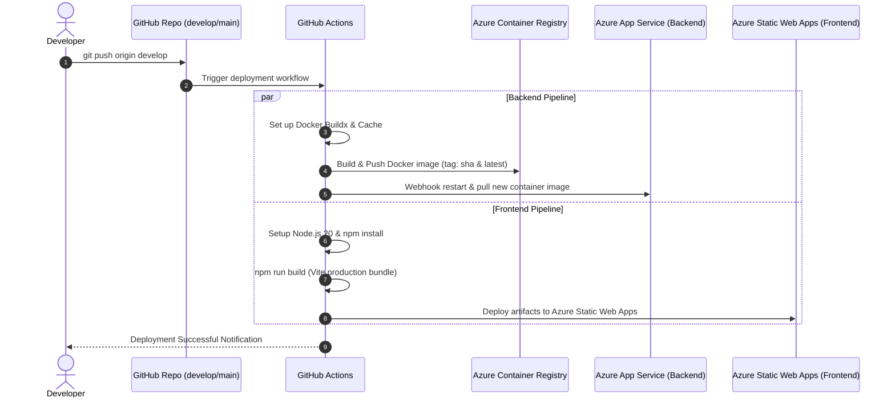

---

## 👥 7. Cấu trúc Thư mục Dự án (Folder Structure)

```text
ChineseMaster/
├── .github/
│   └── workflows/
│       ├── backend-deploy.yml        # CI/CD pipeline deploy backend lên Azure ACR & App Service
│       └── frontend-deploy.yml       # CI/CD pipeline deploy frontend lên Azure Static Web Apps
├── bucha-backend/                    # Spring Boot 3 Backend
│   ├── src/main/java/com/bucha/
│   │   ├── config/                   # Cấu hình bảo mật, Cloudinary, Swagger, CORS
│   │   ├── controller/               # RESTful API Controllers (Auth, Lessons, HSKK, ISE...)
│   │   ├── dto/                      # Data Transfer Objects theo từng module
│   │   ├── entity/                   # JPA Entity models (Users, Curriculum, Flashcard...)
│   │   ├── mapper/                   # MapStruct / ModelMapper
│   │   ├── repository/               # Spring Data JPA Repositories
│   │   ├── security/                 # JWT Authentication Filter, Custom UserDetails
│   │   └── service/                  # Business logic (SRS Algorithm, iFlytek ISE, Doubao...)
│   ├── src/main/resources/           # application.yml, migrations, db schema
│   ├── Dockerfile                    # Multi-stage Dockerfile cho Spring Boot
│   └── docker-compose.yml            # Docker compose backend + MySQL 8 container
├── react-learning-app/               # React 19 Frontend
│   ├── src/
│   │   ├── components/               # Các UI component dùng chung (Navbar, AudioPlayer...)
│   │   ├── constants/                # Tuyến đường, API endpoints
│   │   ├── pages/                    # 17 Pages (HSKKExam, Pronunciation, Flashcards...)
│   │   ├── services/                 # Axios API clients & WebSocket audio recorder
│   │   ├── store/                    # Zustand stores quản lý State người dùng
│   │   └── utils/                    # Xử lý âm thanh, định dạng Pinyin, audio conversion
│   ├── Dockerfile                    # Multi-stage Dockerfile (Node.js build -> Nginx serve)
│   ├── nginx.conf                    # Nginx config cho SPA routing
│   └── vite.config.js                # Vite build config
├── docs/
│   └── screenshots/                  # Thư mục lưu trữ ảnh chụp màn hình demo
└── README.md                         # Tài liệu hướng dẫn dự án
```

---

## 🖼️ 8. Giao diện Demo (UI Showcase)

### 8.1. Trang chủ & Lộ trình học (Dashboard & Curriculum)
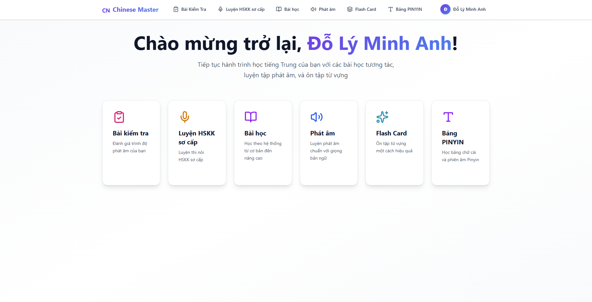

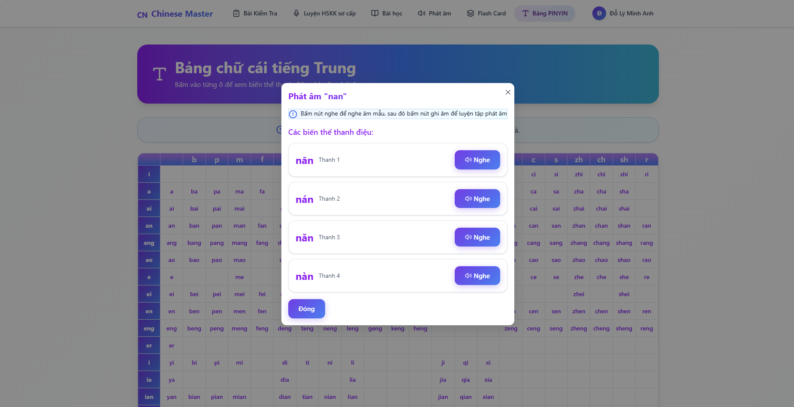

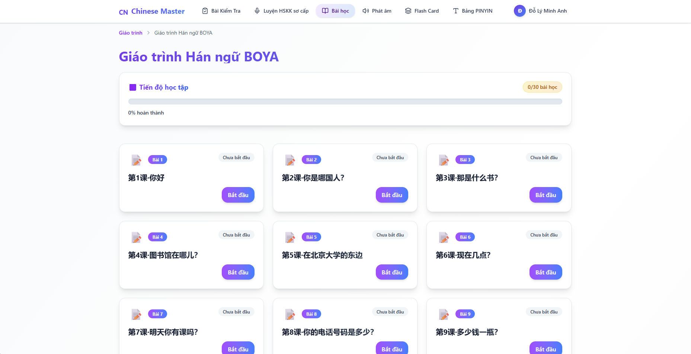

---

### 8.2. Luyện phát âm & Chấm điểm tức thì (iFlytek ISE Pronunciation)
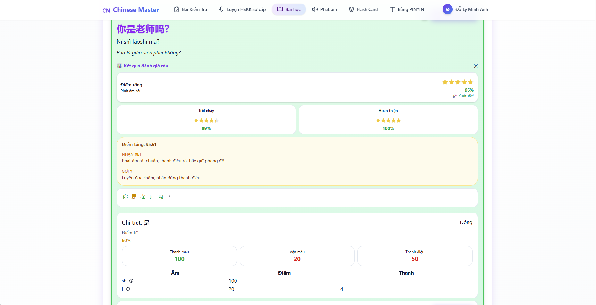

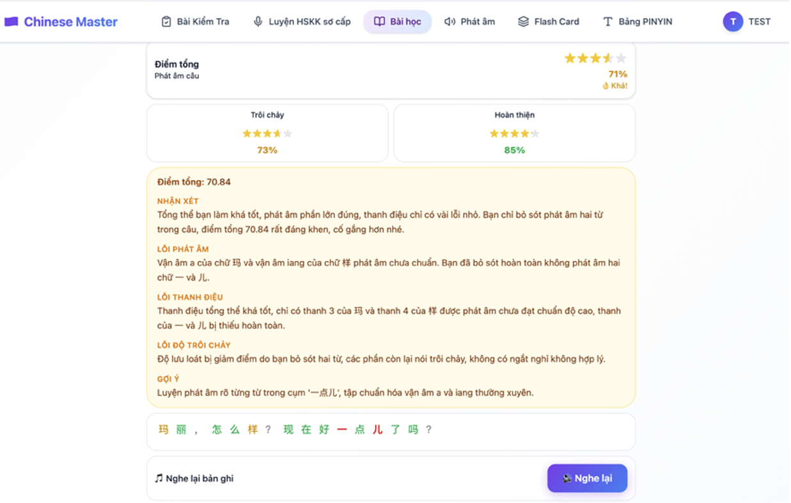

---

### 8.3. Mô phỏng phòng thi Khẩu ngữ HSKK (HSKK Speaking Exam)
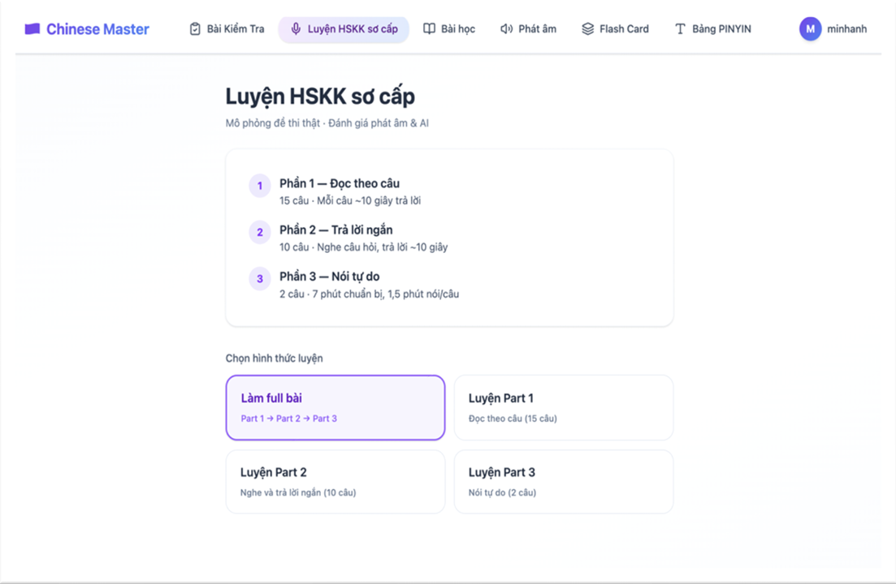

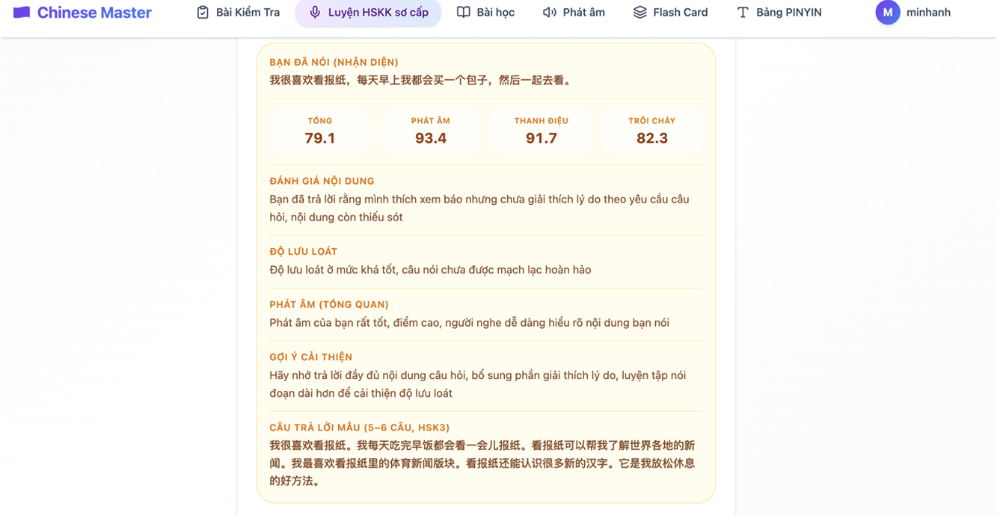

---

### 8.4. Học từ vựng Flashcards với thuật toán Spaced Repetition (SRS SM-2)
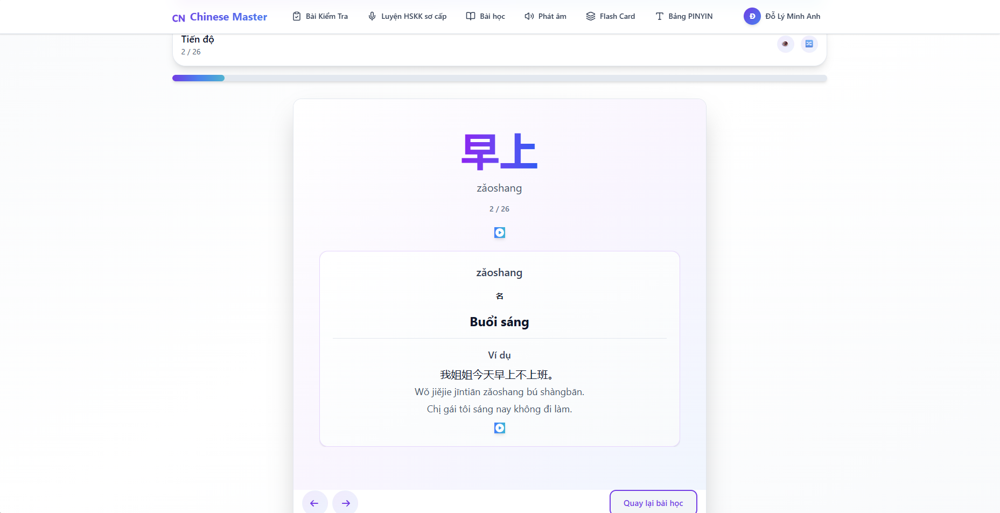

---

### 8.5. Bài kiểm tra đánh giá năng lực phát âm (Assessment Test)
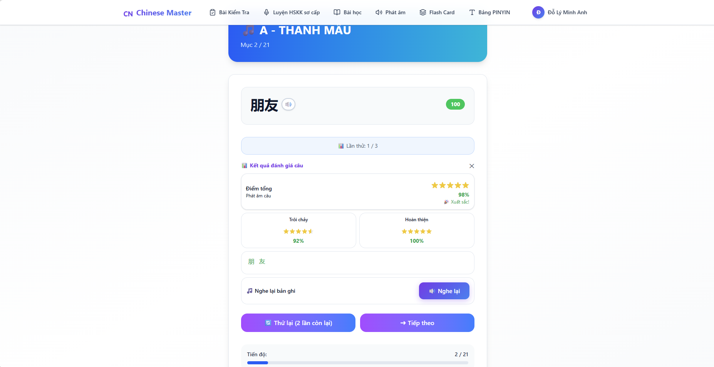

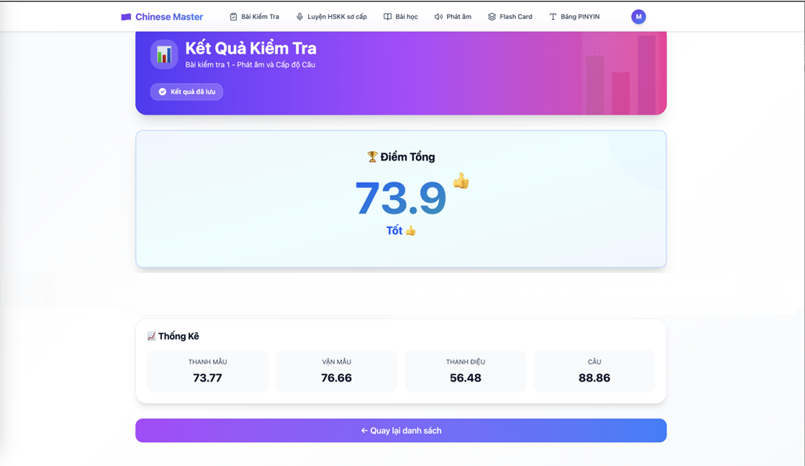

---

### 8.6. Quản lý Lớp học & Bảng xếp hạng (Class Management & Leaderboard)

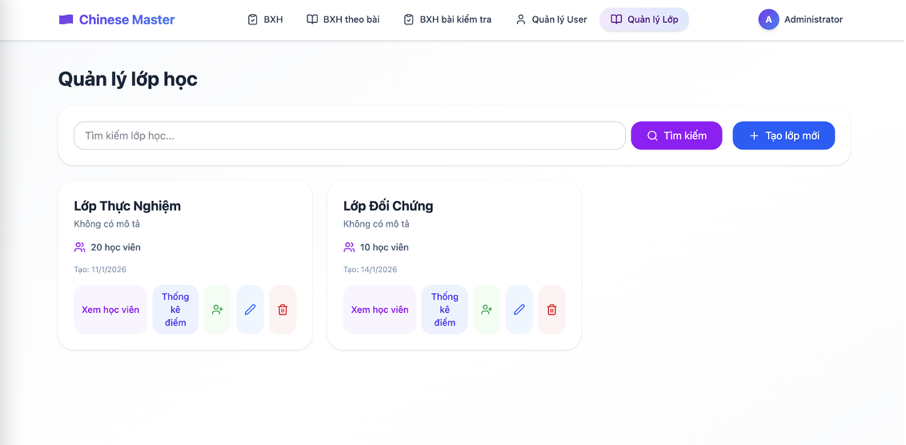

---